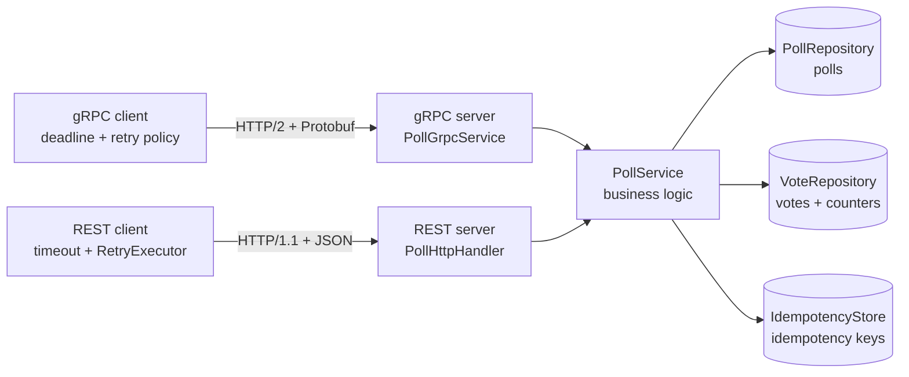
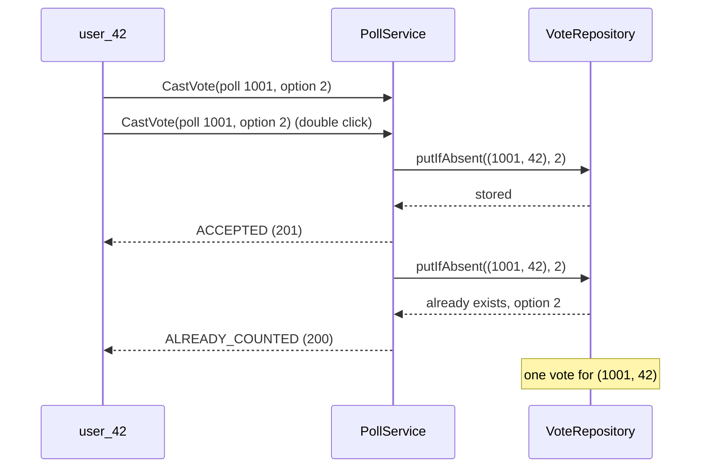
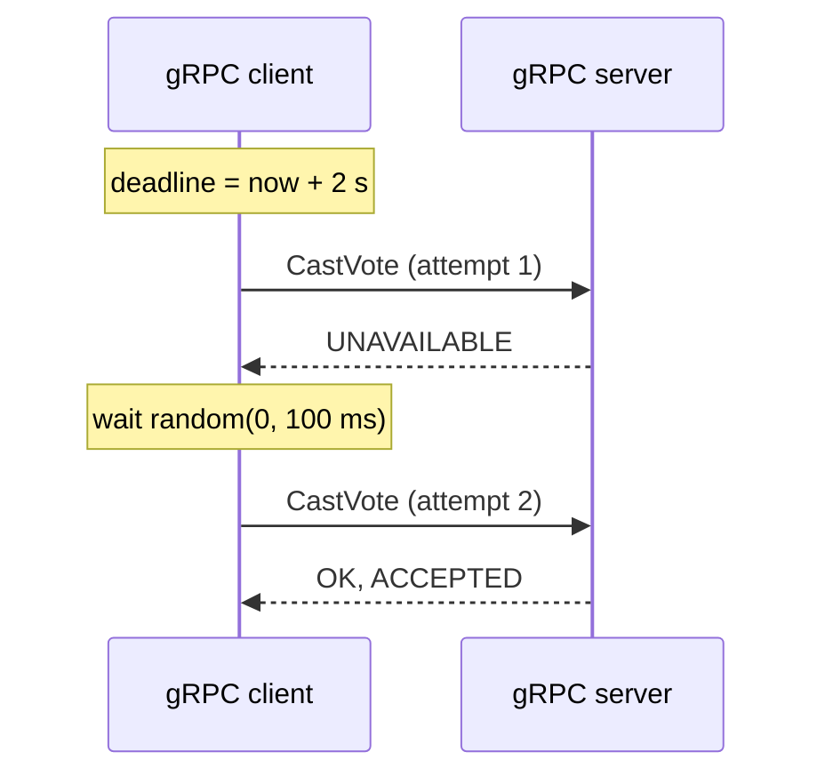

# SIS #2 — Protocol implementation: Polls & Voting over gRPC

Implementation of the Polls & Voting service from SIS #1 (topic T8) in **Java 17** using **gRPC**
(HTTP/2 + Protobuf), with idempotency, timeouts and retries, plus a **REST/JSON baseline**
(HTTP/1.1 + JSON) and a benchmark that compares latency and payload size.

Storage is mocked with in-memory `ConcurrentHashMap`s: the focus of this assignment is the protocol.

## 1. Why gRPC

| Requirement from SIS #1 | How gRPC helps |
|---|---|
| p99 < 100 ms for voting and reading results | Binary Protobuf is faster to encode and decode than JSON; HTTP/2 multiplexes all requests over one connection |
| ~3,000 votes/s, ~30,000 reads/s | Smaller payloads mean less bandwidth and CPU per request |
| Strong consistency of votes, safe retries | Deadlines and a retry policy are built into the gRPC client |
| Internal service-to-service calls | The `.proto` file is a strict contract with generated client and server code |

REST/JSON is the baseline: easier to debug and works in any browser, but sends text and needs hand-written retries.

## 2. Architecture



Both servers call the same `PollService`, so the benchmark measures only the protocol stack.

```
src/main/proto/polls.proto        service contract
src/main/java/kz/highload/polls/
  domain/      PollService and in-memory repositories
  grpc/        gRPC server and Protobuf mapping
  rest/        REST/JSON server (JDK HttpServer + Jackson)
  client/      gRPC and REST clients, retry policy
  fault/       FaultInjector — fails a share of requests to test retries
  benchmark/   load runner, latency statistics, payload meter, report
  ServerApp    runs both servers (gRPC :50051, REST :8080)
src/test/java  unit and integration tests
```

## 3. API

| Operation | gRPC | REST |
|---|---|---|
| Create poll | `CreatePoll` | `POST /v1/polls` + header `Idempotency-Key` |
| Get poll (options, status, my vote) | `GetPoll` | `GET /v1/polls/{pollId}?userId=...` |
| Cast vote | `CastVote` | `POST /v1/polls/{pollId}/votes` |
| Get results | `GetResults` | `GET /v1/polls/{pollId}/results` |
| Close poll early (author only) | `ClosePoll` | `POST /v1/polls/{pollId}/close` |

| Outcome | gRPC | REST |
|---|---|---|
| First vote | `OK`, `ACCEPTED` | `201 Created` |
| Same vote repeated | `OK`, `ALREADY_COUNTED` | `200 OK` |
| Already voted for another option | `ALREADY_EXISTS` | `409 Conflict` |
| Poll closed | `FAILED_PRECONDITION` | `410 Gone` |
| Unknown option / invalid poll | `INVALID_ARGUMENT` | `400 Bad Request` |
| Close by a non-author | `PERMISSION_DENIED` | `403 Forbidden` |
| Poll not found | `NOT_FOUND` | `404 Not Found` |

## 4. Idempotency

| Operation | How it is made safe to repeat |
|---|---|
| CastVote | Natural key `(poll_id, user_id)`, the primary key from SIS #1. `putIfAbsent` works like `INSERT ... ON CONFLICT DO NOTHING`: exactly one vote is stored |
| CreatePoll | Client sends an idempotency key; a repeated request returns the same `poll_id` |
| ClosePoll | `ends_at` is set to `now()` only if the poll is still open; a repeated close changes nothing |
| GetPoll, GetResults | Read-only |



## 5. Timeouts and retries

| | gRPC | REST |
|---|---|---|
| Timeout | Deadline 2 s per call, covers all retries | 2 s per attempt + connect timeout |
| Retries | Built into the channel (service config) | Hand-written `RetryExecutor` |
| Retried errors | `UNAVAILABLE` | I/O errors, timeouts, `503` |
| Policy | 4 attempts, backoff 100 ms × 2, max 1 s, full jitter | same |

Full jitter means a random wait in `[0, backoff]`, so clients do not retry at the same moment.
All operations are idempotent, so every operation may be retried.



`ClientRetryIntegrationTest` starts servers that reject 10 % of requests: all 100 votes still succeed
for both protocols and each vote is stored once.

## 6. How to run

Requirements: JDK 17+ and Maven 3.8+.

```bash
mvn package
java -jar target/polls-grpc.jar --threads=1,16
java -jar target/polls-grpc.jar --threads=16 --failure-rate=0.1 --output=results-faults
java -cp target/polls-grpc.jar kz.highload.polls.ServerApp
```

1. Build, generate gRPC code from the `.proto` and run the tests.
2. Benchmark with 1 and 16 concurrent clients, 5000 requests per run.
3. Benchmark with 10 % injected failures to see retries.
4. Run only the servers (gRPC :50051, REST :8080).

The benchmark writes `benchmark.md`, `latency.csv` and `payload.csv` to the output directory.

## 7. Measurement method

- Both servers run in one JVM on `localhost` and share one `PollService`.
- Both clients run the same workload: a 4-option poll, unique voters, results of that poll.
- Warm-up requests run first and are not measured.
- Latency per request is measured with `System.nanoTime()`; percentiles use the nearest-rank method.
- Load is closed-loop: N threads, each sends the next request when the previous one returns.
- Payload size is the size of the request and response bodies: Protobuf bytes vs JSON bytes.

## 8. Results

### Payload size (body bytes)

| Operation | gRPC request | REST request | gRPC response | REST response | Response saved |
|---|---|---|---|---|---|
| CreatePoll | 105 | 154 | 2 | 12 | 83 % |
| CastVote | 9 | 31 | 2 | 21 | 90 % |
| GetResults (4 options, 1000 votes) | 2 | 0 (GET) | 95 | 268 | 65 % |

- The gRPC CreatePoll body includes the 12-byte idempotency key; in REST it is a header.
- Each gRPC message adds a 5-byte length prefix on the wire.
- Headers are not counted: HTTP/2 compresses them (HPACK), HTTP/1.1 resends them as text every time.

### Latency

Tables from `results/benchmark.md`.

### Conclusions

Written after the benchmark run.
