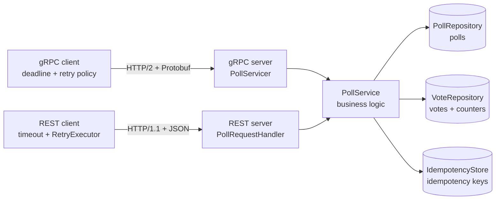
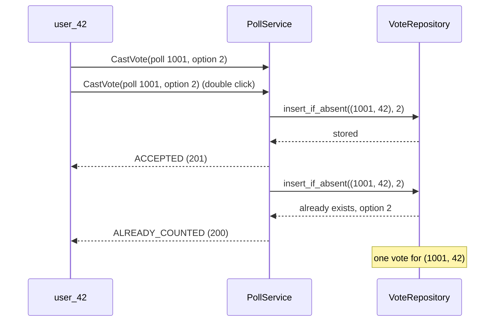
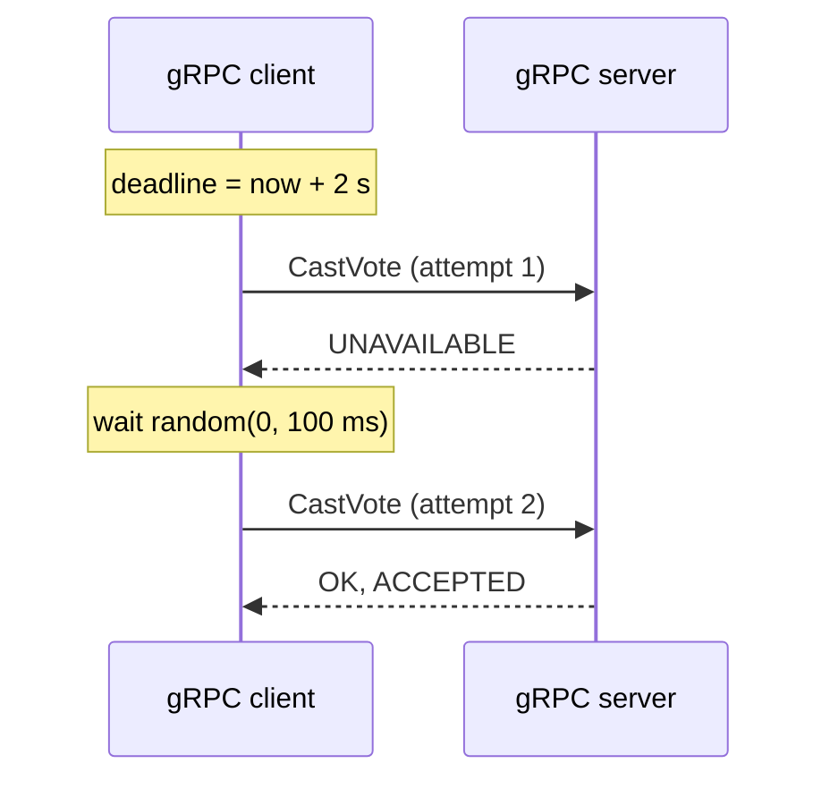

# SIS #2 — Protocol implementation: Polls & Voting over gRPC

Implementation of the Polls & Voting service from SIS #1 (topic T8) in **Python** using **gRPC**
(HTTP/2 + Protobuf), with idempotency, timeouts and retries, plus a **REST/JSON baseline**
(HTTP/1.1 + JSON) and a benchmark that compares latency and payload size.

Storage is mocked with in-memory dictionaries: the focus of this assignment is the protocol.

## 1. Why gRPC

| Requirement from SIS #1 | How gRPC helps |
|---|---|
| p99 < 100 ms for voting and reading results | Binary Protobuf is faster to encode and decode than JSON; HTTP/2 multiplexes all requests over one connection |
| ~3,000 votes/s, ~30,000 reads/s | Smaller payloads mean less bandwidth and CPU per request |
| Strong consistency of votes, safe retries | Deadlines and a retry policy are built into the gRPC client |
| Internal service-to-service calls | The `.proto` file is a strict contract with generated client and server code |

REST/JSON is the baseline: easier to debug and works in any browser, but sends text and needs hand-written retries.
In the full system from SIS #1, browsers talk REST to the API Gateway, and the Gateway calls the internal
services over gRPC.

## 2. Architecture



Both servers call the same `PollService`, so the benchmark measures only the protocol stack.

```
polls_service/
  api/            polls.proto and the code generated from it
  models.py       Poll, VoteOutcome, PollResults and other data classes
  service.py      PollService — business logic
  repositories.py in-memory storage of polls, votes and idempotency keys
  grpc_server.py  gRPC server and fault-injection interceptor
  rest_server.py  REST/JSON server (standard library http.server)
  grpc_client.py  gRPC client with deadline and retry policy
  rest_client.py  REST client with timeout and retries
  retry.py        retry policy shared by both clients
  fault.py        FaultInjector — fails a share of requests to test retries
  server_app.py   runs both servers (gRPC :50051, REST :8080)
  benchmark/      load runner, latency statistics, payload meter, report
tests/            unit and integration tests
```

## 3. API

| Operation | gRPC | REST |
|---|---|---|
| Create poll | `CreatePoll` | `POST /v1/polls` + header `Idempotency-Key` |
| Get poll (options, status, my vote) | `GetPoll` | `GET /v1/polls/{pollId}?userId=...` |
| Cast vote | `CastVote` | `POST /v1/polls/{pollId}/votes` |
| Get results | `GetResults` | `GET /v1/polls/{pollId}/results` |
| Close poll early (author only) | `ClosePoll` | `POST /v1/polls/{pollId}/close` |

| Outcome | gRPC | REST |
|---|---|---|
| First vote | `OK`, `ACCEPTED` | `201 Created` |
| Same vote repeated | `OK`, `ALREADY_COUNTED` | `200 OK` |
| Already voted for another option | `ALREADY_EXISTS` | `409 Conflict` |
| Poll closed | `FAILED_PRECONDITION` | `410 Gone` |
| Unknown option / invalid poll | `INVALID_ARGUMENT` | `400 Bad Request` |
| Close by a non-author | `PERMISSION_DENIED` | `403 Forbidden` |
| Poll not found | `NOT_FOUND` | `404 Not Found` |

## 4. Idempotency

| Operation | How it is made safe to repeat |
|---|---|
| CastVote | Natural key `(poll_id, user_id)`, the primary key from SIS #1. The vote is stored only if the key is absent, like `INSERT ... ON CONFLICT DO NOTHING`: exactly one vote is stored |
| CreatePoll | Client sends an idempotency key; a repeated request returns the same `poll_id` |
| ClosePoll | `ends_at` is set to now only if the poll is still open; a repeated close changes nothing |
| GetPoll, GetResults | Read-only |



## 5. Timeouts and retries

| | gRPC | REST |
|---|---|---|
| Timeout | Deadline 2 s per call, covers all retries | 2 s per attempt |
| Retries | Built into the channel (service config) | Hand-written `RetryExecutor` |
| Retried errors | `UNAVAILABLE` | connection errors, timeouts, `503` |
| Policy | 4 attempts, backoff 100 ms × 2, max 1 s, jitter | same |

Jitter means a random wait in `[0, backoff]`, so clients do not retry at the same moment.
All operations are idempotent, so every operation may be retried.



`tests/test_clients.py` starts servers that reject every third request: all 100 votes still succeed
for both protocols and each vote is stored once.

## 6. How to run

Requirements: Python 3.10+.

```bash
pip install -r requirements.txt
python -m pytest
python -m polls_service.benchmark --threads=1,16
python -m polls_service.benchmark --threads=16 --failure-rate=0.1 --output=results-faults
python -m polls_service.server_app
python -m polls_service.demo
```

1. Install dependencies.
2. Run the tests.
3. Benchmark with 1 and 16 concurrent clients, 2000 requests per run.
4. Benchmark with 10 % injected failures to see retries.
5. Run only the servers (gRPC :50051, REST :8080).
6. In a second terminal, while the servers are running: call every gRPC method once and print the answers.

The benchmark writes `benchmark.md`, `latency.csv` and `payload.csv` to the output directory.

After changing `polls.proto`, regenerate the gRPC code:

```bash
python -m grpc_tools.protoc -I . --python_out=. --grpc_python_out=. polls_service/api/polls.proto
```

## 7. Measurement method

- Servers run in a separate process, so the client and the servers do not share the Python GIL.
- Both servers share one `PollService`.
- Both clients run the same workload: a 4-option poll, unique voters, results of that poll.
- Warm-up requests run first and are not measured.
- Latency per request is measured with `time.perf_counter_ns()`; percentiles use the nearest-rank method.
- Load is closed-loop: N threads, each sends the next request when the previous one returns.
- Payload size is the size of the request and response bodies: Protobuf bytes vs JSON bytes.

## 8. Results

### Latency, no failures

| Protocol | Operation | Threads | p50 ms | p95 ms | p99 ms | Throughput rps | Errors |
|---|---|---|---|---|---|---|---|
| gRPC | CreatePoll | 1 | 0.823 | 0.959 | 1.057 | 1186 | 0 |
| gRPC | CastVote | 1 | 0.822 | 1.022 | 1.163 | 1176 | 0 |
| gRPC | GetResults | 1 | 0.847 | 0.984 | 1.099 | 1154 | 0 |
| REST/JSON | CreatePoll | 1 | 1.787 | 2.275 | 2.584 | 538 | 0 |
| REST/JSON | CastVote | 1 | 1.581 | 1.846 | 2.080 | 622 | 0 |
| REST/JSON | GetResults | 1 | 1.600 | 1.836 | 2.004 | 615 | 0 |
| gRPC | CreatePoll | 16 | 7.213 | 7.812 | 8.211 | 2200 | 0 |
| gRPC | CastVote | 16 | 6.825 | 7.340 | 7.627 | 2335 | 0 |
| gRPC | GetResults | 16 | 7.560 | 8.119 | 8.407 | 2107 | 0 |
| REST/JSON | CreatePoll | 16 | 21.611 | 33.127 | 39.768 | 712 | 0 |
| REST/JSON | CastVote | 16 | 20.658 | 32.412 | 37.138 | 744 | 0 |
| REST/JSON | GetResults | 16 | 20.116 | 32.051 | 39.156 | 755 | 0 |

### Latency, 10 % injected failures, 16 threads

| Protocol | Operation | p50 ms | p95 ms | p99 ms | Throughput rps | Errors |
|---|---|---|---|---|---|---|
| gRPC | CreatePoll | 21.951 | 155.569 | 351.006 | 395 | 1 |
| gRPC | CastVote | 22.193 | 161.937 | 227.372 | 376 | 1 |
| gRPC | GetResults | 25.255 | 163.831 | 359.091 | 363 | 0 |
| REST/JSON | CreatePoll | 21.160 | 98.394 | 146.589 | 524 | 1 |
| REST/JSON | CastVote | 18.724 | 84.850 | 130.664 | 605 | 0 |
| REST/JSON | GetResults | 15.115 | 94.256 | 153.931 | 613 | 1 |

### Payload size (body bytes)

| Operation | gRPC request | REST request | gRPC response | REST response | Response saved |
|---|---|---|---|---|---|
| CreatePoll | 105 | 154 | 2 | 12 | 83 % |
| CastVote | 9 | 31 | 2 | 21 | 90 % |
| GetResults (4 options, 1000 votes) | 2 | 0 (GET) | 95 | 268 | 65 % |

- The gRPC CreatePoll body includes the 12-byte idempotency key; in REST it is a header.
- Each gRPC message adds a 5-byte length prefix on the wire.
- Headers are not counted: HTTP/2 compresses them (HPACK), HTTP/1.1 resends them as text every time.

